# Boosting Innovation | Parallel Prediction Model Based on Informer-LSTM

● Dataset: Wind power dataset, power data set, wind speed dataset, etc. of a wind farm
● Environment Framework: Python 3.9, PyTorch 1.8 and above can be run.
● Step-by-step prediction model score: 0.98 on test set
● Usage Object: Paper requirements, graduation design requirements.
● Code Guarantee: The code comments are detailed and ready to run.
\n        \n  
This issue proposes an Informer-LSTM parallel prediction model based on a wind power power data set, which significantly improves the prediction effect in single step prediction tasks!
\tEffectiveness comparison:
LSTM Predictive Model:
Model Evaluation:
\n        \n  
Predictive Visualization:
Informer-LSTM Parallel Prediction Model:
Model Evaluation:
\t  
\n        \n  
\tPredictive Visualization:
\n        \n  
We also provide experiments and comparisons based on multiple datasets in multiple prediction tasks, and provide detailed documentation and tutorials including how to replace your own dataset, parameter tuning tutorials, and replacement of prediction tasks. The code is commented line by line, with detailed introductions to parameters.
1. Introduction to Model Innovation Points
1.1 Combine the advantages of Informer and RNN
Informer: Expert in handling long sequences, capable of parallel computation, enhancing computational efficiency and predictive performance. Informer has been improved on the basis of Transformer to better suit time series data, especially those with long-term dependencies.
LSTM: Excellent in capturing the short-term and long-term dependencies of sequence data, capable of handling temporal relationships within sequence data effectively.
By using both models in parallel, it is possible to better capture patterns at different time scales, thereby improving the accuracy and robustness of predictions.
\t1.2 Parallel Model Architecture\tBy using Informer and LSTM in parallel, two branches can learn simultaneously, allowing the model to extract and process information at different temporal scales:
Informer Part: Handles global sequential patterns effectively, capable of processing long-term sequence data.
\tLSTM Part: Processing local temporal patterns, effectively capturing short-term dependencies and the dynamic changes of sequence data.
This architecture can more comprehensively capture the characteristics of sequential data, enhancing the model's predictive performance.
\t1.3 Model Fusion \tConcatenate the outputs of Informer and LSTM, and fuse the features of different models through a fully connected layer. This fusion method enables the model to simultaneously utilize the global information extraction capability of Informer and the local temporal relationship modeling capability of LSTM.
1.4 Adapt to various temporal tasks
Single-variable time series prediction: Prediction for a single time series.
Multivariate time series prediction: joint prediction of multiple time series.
Flexible adjustments for single-step and multi-step prediction tasks.
By adjusting the dimensions of input features and model structure, it can be flexibly applied to various time series prediction tasks.
\t1.5 Efficient Computation \tThe use of Informer significantly enhances the efficiency of long-term sequence computation, while the LSTM ensures the full utilization of local temporal information. This combination not only guarantees efficient computation but also improves the accuracy and reliability of predictions.
2. Informer Detailed Explanation, Three Major Innovations
2.1 Probability
1. Probabilistic Sparse Self-Attention: This is a sparse self-attention mechanism introduced in the Informer model. The core idea is to select the most important part of attention weights through probability methods, while ignoring those that have a smaller impact on the result. This method can significantly reduce computational complexity while maintaining high model performance.
2. Sparse Self-Attention: Unlike the dense self-attention mechanism of standard Transformers, Informer introduces ProbSparse Self-attention. It selects important Q-K pairs for computation through a probability sampling mechanism, reducing computational complexity.
3. Efficiency Improvement: The sparse attention mechanism significantly reduces computational complexity from O(L2⋅d) to O(L⋅log(L)⋅d), where L is the sequence length and d is the feature dimension per time step.
4. Multi-Scale Feature Extraction - Information Distillation
In the architecture diagram of Informer, unlike Transformer, there is no notation indicating the stacking of N Encoders on the left side of the encoder, but rather two trapezoids of different sizes.
When looking horizontally at an individual Encoder (i.e., the large trapezoid on the left side of the architecture diagram, which represents the main stack of the entire input sequence).
The Encoder's role is Self-attention Distilling. Since many ProbSparse self-related mechanisms are filled with V's mean, there naturally exists redundant attention sources. Therefore, convolution and pooling are applied between adjacent Attention Blocks to downsample features. Thus, when designing the Encoder, distillation operations are continuously extracted to focus on key features, thereby obtaining feature maps worth paying attention to.
Multi-scale Time Series Feature Extraction: Informer models features at different temporal granularities through multi-scale approaches, effectively capturing the multi-scale dependencies in time series.
Information distillation: Utilizes an information distillation mechanism, progressively reducing the temporal step size through hierarchical time-convolutional pooling layers to extract features at different scales, achieving efficient modeling over long temporal dependencies.
Convolutional Dimensionality Reduction: Using a 1D convolutional pooling layer in the encoder for dimensionality reduction, with a stride of 2 to half the sequence length, further reducing computational complexity.
Information compression: Through convolutional pooling layers, information is compressed, condensing long sequences of data into shorter time steps, thereby enabling more efficient temporal modeling.
2.3 Time coding
\tInformer\tNot only has the Transformer architecture's essential Position Embedding been added to the original vector, but various encodings related to time have also been added:
\tDay cycle code: indicates a time point in a day.
\tWeekly cycle code: Represents a point in time within a week.
Month cycle code: Represents a point in time within a month.
In LSTF issues, the ability to capture remote independence requires global information such as hierarchical timestamps (week, month, year) and unknowable timestamps (holidays, events).
The specific addition of what kind of GlobalTimeStamp is needed to be added here still needs to be confirmed according to the actual problem. If calculating the passenger flow at high-speed train stations, it is evident that the "holiday" time difference is very important. If calculating the passenger flow of public transportation such as buses and subways, it is clear that "weekday" can reveal whether it is a working day.
3. Data Introductions on Wind Power Power and Other Datasets
3.1 Import Data
\t  
The wind power dataset consists of 35,040 samples with 15 features. The first 6,000 samples are selected for visualization.
3.2 Introduction to Other Datasets
\tRefer to previous articles:
3.3 Data Set Production and Preprocessing
Detailed information is provided in the document!

4 Parallel Prediction Model Based on Informer-LSTM
4.1 Define the Informer-LSTM parallel prediction network model
4.2 Set parameters, train the model
50 epochs, MSE of 0.01283, the Informer-LSTM parallel prediction effect is significant. The model can fully utilize the long-term dependency modeling ability of Informer and the short-term dependency capturing ability of LSTM, converge quickly, have excellent performance, high prediction accuracy, and further improve the model's predictive performance by appropriately adjusting model parameters.
5 Results Visualization and Model Evaluation
5.1 Prediction result visualization
5.2 Model evaluation
From the prediction results, it can be seen that under the Informer-LSTM parallel prediction model, the fitting effect is good. Through this design, we can fully utilize the advantages of Informer and LSTM to achieve efficient and accurate time series prediction, with a significant combined prediction effect!
6 Tuning Parameters for Informer-LSTM Parallel Model
In developing and tuning the Informer-LSTM parallel prediction model, tuning parameters is a key step. By reasonable parameter adjustment, the model's performance can be significantly improved. See detailed tutorials in the document!
6.1 Model architecture parameters
Informer part:
d_model: The hidden layer dimension of the model. Generally starts from 128 or 256, gradually adjusted to 512 or even higher.
n_heads: The number of attention heads. Common values are 4 or 8, which can be adjusted according to the hidden layer dimension.
n_layers: The number of encoding layers and decoders in the Informer. Generally set between 2-6 layers, more layers may enhance the model's expressiveness but also increase computational overhead.
\tLSTM Part\thidden_dim: Dimension of the hidden layer in the LSTM. Starts from 128 or 256, and can be adjusted as needed.
\tnum_lstm_layers: Number of LSTM layers. Generally, it is set to 1-3 layers, and more layers can increase the complexity and expressiveness of the model.
6.2 Training Parameters\tbatch_size: The size of the batch for each training iteration. Common values are 32, 64, or 128, adjusted according to memory size and model complexity.
\tlearning_rate: The learning rate. Initially, it is generally set to 1e-3 or 1e-4, which can be dynamically adjusted using a learning rate scheduler.
\tepochs: The number of training rounds. Typically starts from 50-100, adjusted according to the model's convergence.
6.2 Regularization and Optimizers\tdropout: Dropout rate. Common values are 0.1-0.3, used to prevent overfitting.
\tweight_decay: Weight decay coefficient. Common values are 1e-4, used for L2 regularization.
\toptimizer: Optimizer. Commonly used are Adam or AdamW, but other optimizers such as SGD can be tried.
Click to download: Complete original data, Python code
Previously Featured Content:
Time Series Forecasting: Analysis and comparison of LSTM, ARIMA, Holt-Winters, SARIMA models
Wind Speed Prediction (Part 1) Data Set Introduction and Preprocessing
Wind Speed Prediction (II) EMD-LSTM Model Based on Pytorch
Wind Speed Prediction (III) EMD-LSTM-Attention Model
Wind Speed Prediction (IV) EMD-Transformer Model Based on Pytorch
Wind Speed Prediction (5) EMD-CNN-LSTM Model Based on Pytorch
Wind Speed Prediction (VI) - EMD-CNN-GRU Parallel Model Based on Pytorch
CEEMDAN + Combination Prediction Model (BiLSTM-Attention + ARIMA)
CEEMDAN + Combination Prediction Model (CNN-LSTM + ARIMA)
CEEMDAN + Combination Prediction Model (Transformer - BiLSTM + ARIMA)
CEEMDAN + Combination Prediction Model (CNN-Transformer + ARIMA)
Multi-Feature Variable Sequence Forecasting (I) - CNN-LSTM Wind Speed Forecasting Model
Multi-Feature Variable Sequence Forecasting (II) - CNN-LSTM-Attention Wind Speed Forecasting Model
Multi-Feature Variable Sequence Forecasting (III) - CNN-Transformer Wind Speed Forecasting Model
Multi-Feature Variable Sequence Forecasting (IV) Transformer-BiLSTM Wind Speed Forecasting Model
Multi-Feature Variable Sequence Forecasting (V) CEEMDAN+CNN-LSTM Wind Speed Forecasting Model
Multi-Feature Variable Sequence Forecasting (VI) CEEMDAN+CNN-Transformer Wind Speed Forecasting Model
Prediction Model Based on the Particle Swarm Optimization Algorithm SSA - CEEMDAN-BiLSTM-Attention
Prediction Model Based on the Particle Swarm Optimization Algorithm SSA - CEEMDAN-Transformer-BiGRU
Superior Prediction Model: Secondary Decomposition-Combination Prediction
Multi-Feature Variable Sequence Forecasting (VII) CEEMDAN+Transformer-BiLSTM Forecasting Model
Multi-Feature Variable Sequence Forecasting (VIII) Prediction Model Based on the Particle Swarm Optimization Algorithm for CEEMDAN-SSA-BiLSTM
Multi-Feature Variable Sequence Forecasting (11) Prediction Model Based on Pytorch's TCN-GRU
VMD + CEEMDAN Secondary Decomposition, CNN-LSTM Forecasting Model
VMD + CEEMDAN 2nd Decomposition, CNN-Transformer Prediction Model
VMD + CEEMDAN 2nd Decomposition, Transformer-BiGRU Prediction Model
Prediction Model Based on the Particle Swarm Optimization Algorithm SSA - Complete Code Kit
| Superior Combination Prediction Model!
High Innovation | CEEMDAN + SSA-TCN-BiLSTM-Attention Prediction Model
| Superior Combination Prediction Model!
Lowest Price Online | Continuous Updates for the Complete Kit!
| Parallel Prediction Model Based on TCN-SENet + BiGRU-GlobalAttention
Second Decomposition - Innovative Model Prediction Complete Kit
| BiTCN-BiGRU-CrossAttention Fusion of Spatiotemporal Features High Innovation Prediction Model
Combination Prediction Update | Superior Combination Prediction Model!
Parallel Prediction Model with Fusion of Spatiotemporal Features by BiTCN-Transformer
| Multi-level Attention Mechanism Parallel Prediction Model
| CEEMDAN-CNN-GRU-GlobalAttention + XGBoost Combination Prediction
Multi-Step Prediction Series | LSTM, CNN, Transformer, TCN, Serial, Parallel Model Collection
END
\t2. Friends who like can click to follow, give the article a "like", share on WeChat Moments or discuss groups

## Images

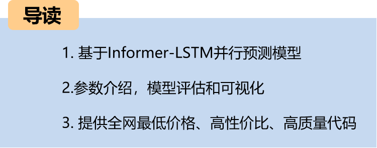
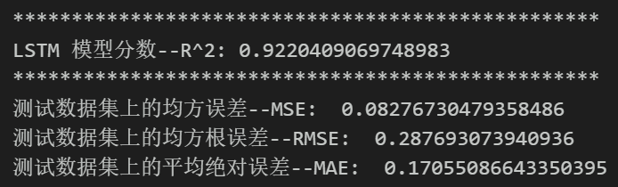
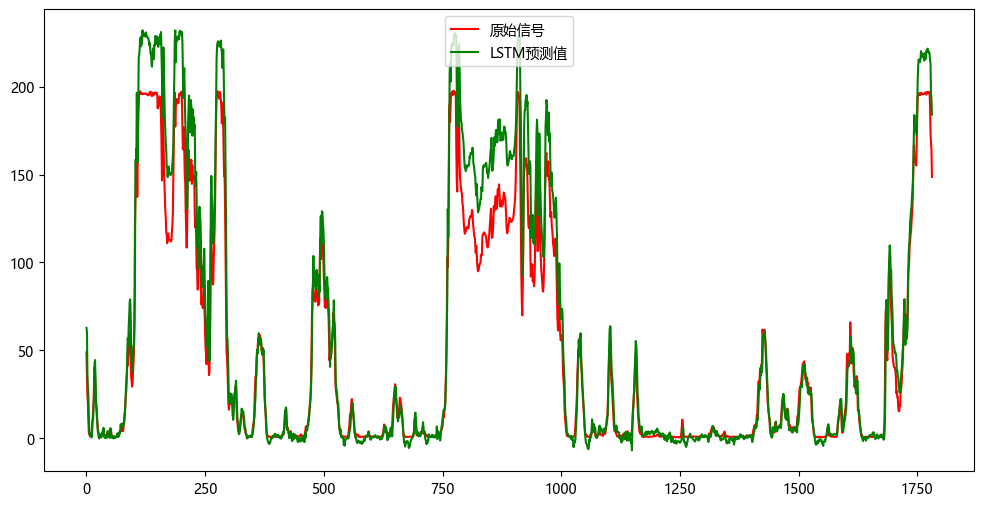

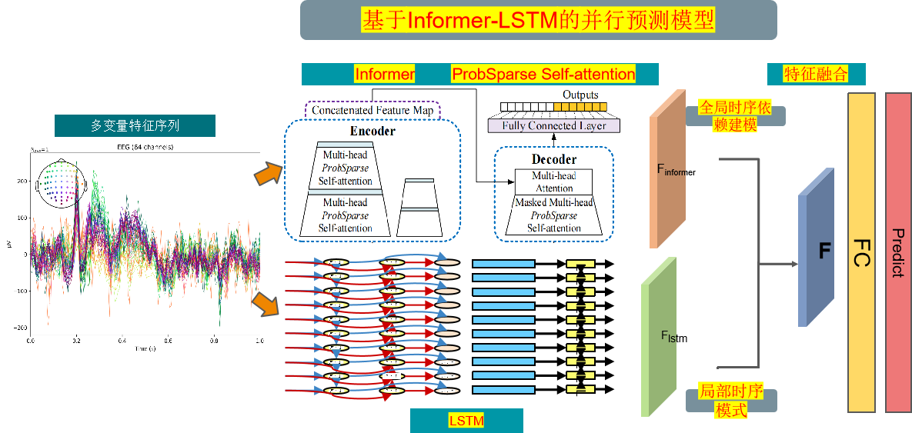

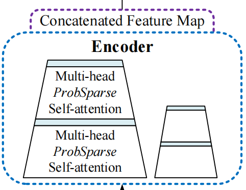
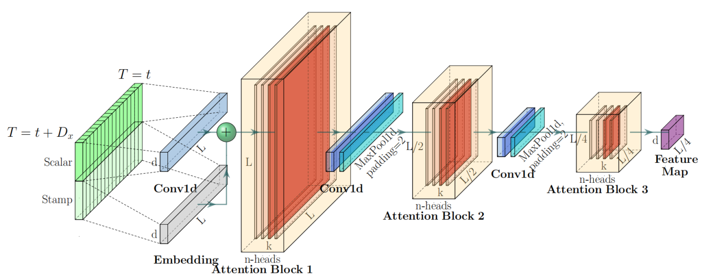
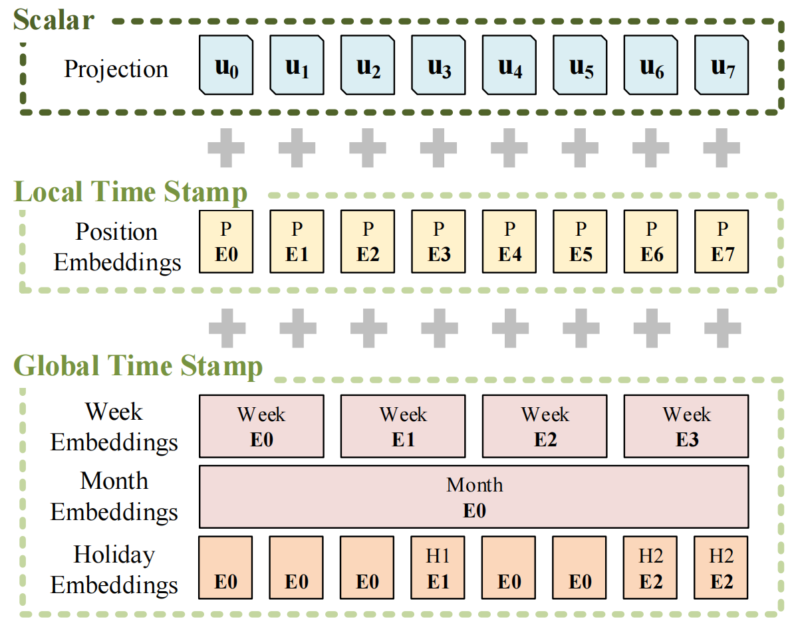
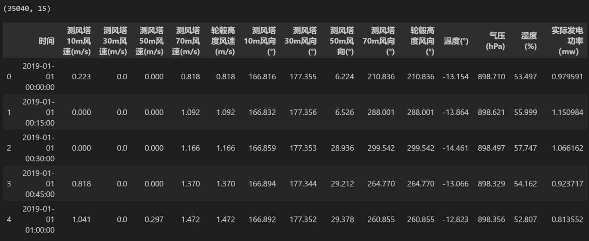

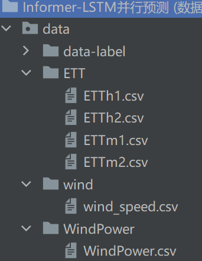
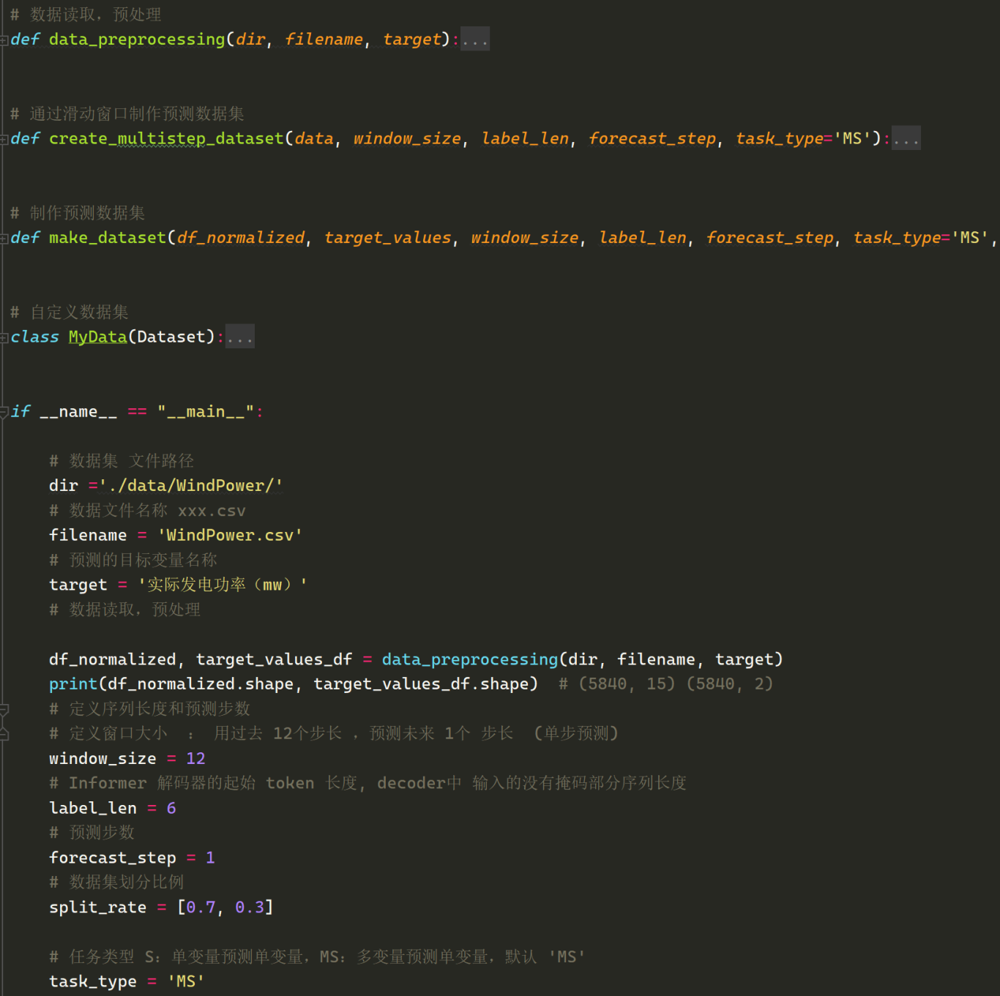
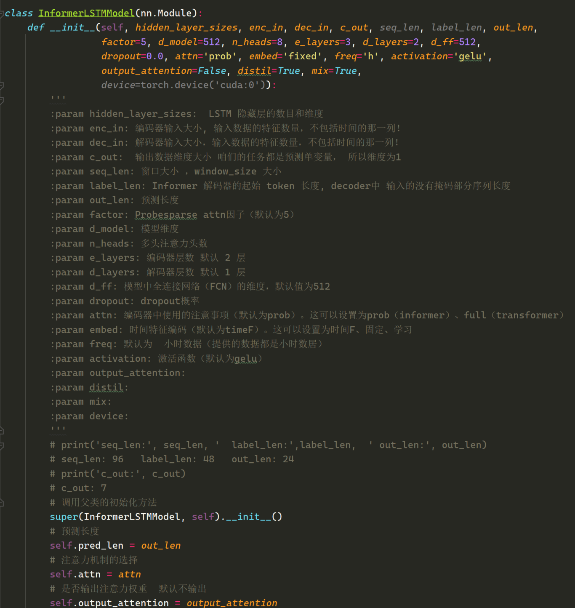
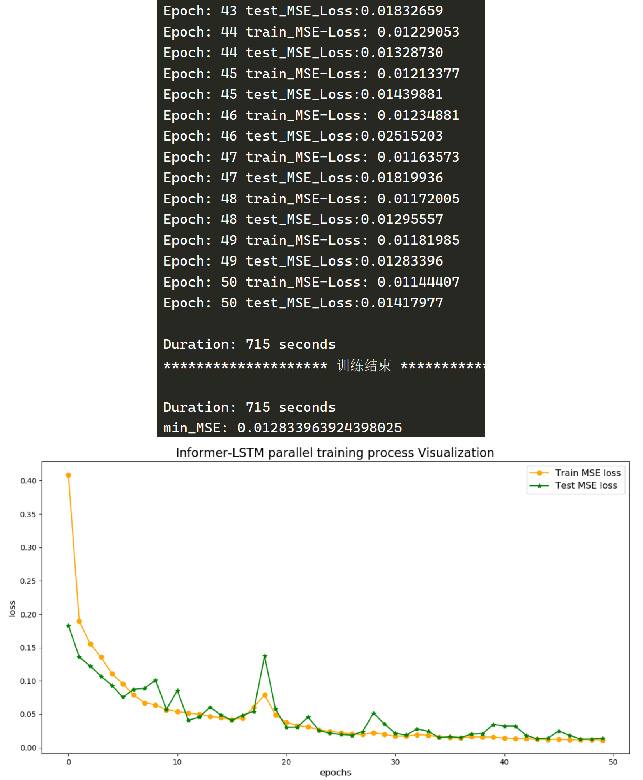
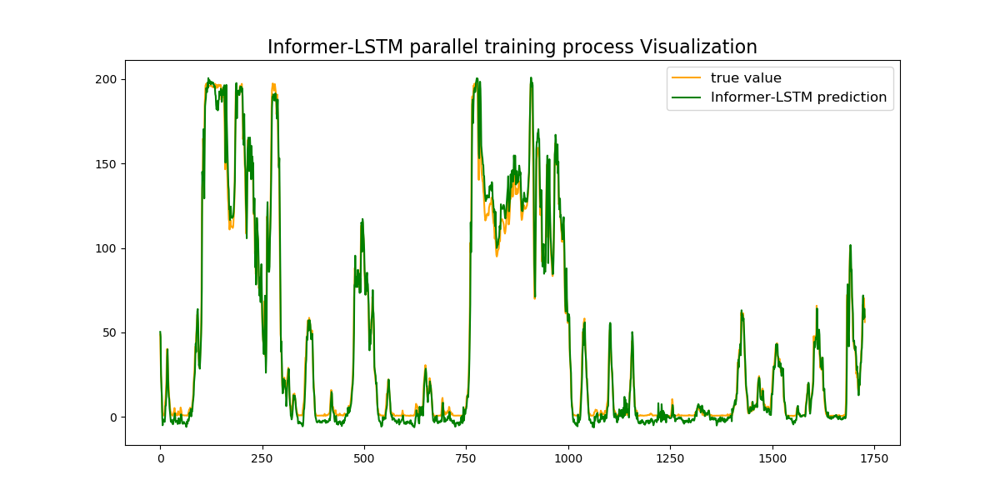
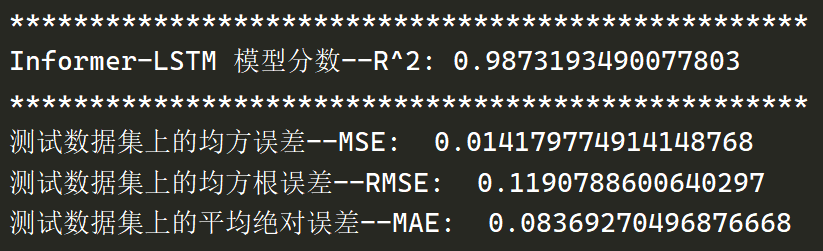
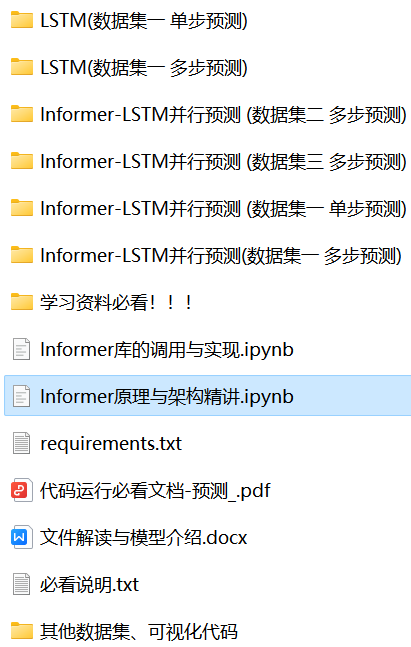

<!-- PAYMENT_BLOCK -->

## Get this dataset

- Payment link (Stripe): [Buy now](https://buy.stripe.com/3cs8yP7sY87d0vu9AB)
- Payment QR code: 

<!-- /PAYMENT_BLOCK -->
